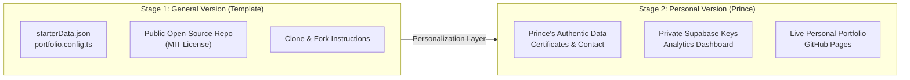

# DyPortfolio — Portfolio & Resume Coverage Report

This document audits the field-level data coverage, structural schema, and feature completeness across both the **Public Portfolio Website** and the **Dynamic Resume Engine**.

---

## 1. Executive Coverage Summary

| Domain | Portfolio Coverage | Resume Engine Coverage | Dynamic / Admin Editable |
| :--- | :---: | :---: | :---: |
| **Personal Branding & Contact** | 100% | 100% | Yes (`portfolio.config.ts`) |
| **Career & Experience** | 100% | 100% (Checklist toggleable) | Yes (DB & Fallback JSON) |
| **Project Showcase** | 100% | 100% (Checklist toggleable) | Yes (DB & Fallback JSON) |
| **Technical Skills Taxonomy** | 100% | 100% (Category toggleable) | Yes (DB & Fallback JSON) |
| **Certificates & Credentials** | 100% | 100% (Optional inclusion) | Yes (Direct Storage Upload) |
| **Dynamic Personal Details** | 100% | 100% (Optional inclusion) | Yes (Languages, Hobbies CRUD) |
| **Education & Honors** | 100% | 100% (Formatted) | Yes (DB & Fallback JSON) |
| **1-Page ATS Compliance** | N/A | 100% (Strict A4 Bounds) | Dynamic Density Controls |
| **Download Audit & Telemetry** | 100% | 100% (Timestamp + Lead Modal)| Yes (`download_logs` Table) |

---

## 2. Field-Level Coverage Matrix

### 2.1. Profile & Personal Branding
| Field Name | Type | Portfolio Rendering | Resume PDF Rendering | Config / Source |
| :--- | :--- | :--- | :--- | :--- |
| `name` | `string` | Hero title & Navbar brand | Header primary headline | `portfolio.config.ts` |
| `titles` | `string[]` | Typing headline & hero badges | Sub-headline under name | `portfolio.config.ts` |
| `bio` | `string` | Hero paragraph & About page | Summary / Objective bullet | `portfolio.config.ts` |
| `location` | `string` | Footer & About page | Header contact bar | `portfolio.config.ts` |
| `email_personal` | `string` | Footer email link | Contact line | `portfolio.config.ts` |
| `email_pro` | `string` | Footer email link | Contact line (selectable) | `portfolio.config.ts` |
| `linkedin_url` | `string` | Footer icon & About page | Header clickable link | `portfolio.config.ts` |
| `github_url` | `string` | Navbar & Footer icon | Header clickable link | `portfolio.config.ts` |
| `x_twitter_url` | `string` | Footer icon | Optional contact item | `portfolio.config.ts` |
| `facebook_url` | `string` | Footer icon | N/A (excluded for ATS) | `portfolio.config.ts` |

### 2.2. Experience & Career Roles
| Field Name | Type | Description | Resume Inclusion Filter |
| :--- | :--- | :--- | :--- |
| `title` | `string` | Job role / Position (e.g. Fullstack Engineer) | Included by default |
| `company` | `string` | Organization or Company name | Included by default |
| `location` | `string` | City, State or "Remote" | Included by default |
| `start_date` / `end_date` | `string` | e.g. "Jan 2024 - Present" | Included by default |
| `description` | `string[]` | Action-driven achievement bullet points | Individual bullets toggleable |
| `tags` | `string[]` | Role domains (e.g. `frontend`, `backend`, `cloud`) | Preset filter matches tags |
| `is_active` | `boolean` | Global visibility switch | Excluded if false |

### 2.3. Projects Showcase
| Field Name | Type | Description | Resume Inclusion Filter |
| :--- | :--- | :--- | :--- |
| `title` | `string` | Project name | Included when project checked |
| `subtitle` | `string` | Brief elevator pitch / tagline | Included under title |
| `tech_stack` | `string[]` | Technologies used (e.g. React, Supabase) | Inline tech pills / tags |
| `bullet_points` | `string[]` | Architecture, deliverables, impact | 2-3 concise bullets in PDF |
| `github_url` | `string` | Link to public repository | Clickable hyperlink in PDF |
| `live_url` | `string` | Link to deployed web application | Clickable hyperlink in PDF |
| `tags` | `string[]` | Category tags (e.g. `web`, `mobile`, `ai`) | Filterable by role preset |

### 2.4. Technical Skills Taxonomy
| Skill Group | Examples Included | Resume Rendering | Role Preset Association |
| :--- | :--- | :--- | :--- |
| **Languages** | TypeScript, JavaScript, Python, SQL, C++, HTML/CSS | Horizontal compact list | Developer, Systems |
| **Frameworks / Web** | React, Next.js, Node.js, Express, Tailwind CSS | Horizontal compact list | Developer, Fullstack |
| **Databases & Storage** | PostgreSQL, Supabase, Redis, MongoDB | Horizontal compact list | Systems, Fullstack |
| **DevOps & Cloud** | Git, GitHub Actions, Docker, Vercel, Linux | Horizontal compact list | Systems, Developer |
| **Architecture & Tools**| REST APIs, WebSocket, CI/CD, Vite, Postman | Horizontal compact list | All Presets |

### 2.5. Certificates & Credentials
| Field Name | Type | Portfolio Presentation | Resume PDF Presentation | Admin Editable |
| :--- | :--- | :--- | :--- | :---: |
| `title` | `string` | Card title | One-line credential entry | Yes |
| `issuer` | `string` | Badge with issuer logo/text | Issuer name | Yes |
| `issue_date` | `date` | Displayed on card | Year / Month | Yes |
| `credential_url` | `string` | Verification external link | Clickable hyperlink | Yes |
| `file_url` | `string` | Full image/PDF viewer modal | N/A (vector text used) | Yes (Storage upload) |
| `is_visible` | `boolean` | Live show/hide toggle | Governs inclusion | Yes (1-click toggle) |

### 2.6. Dynamic Personal Details (Extensible)
| Field Name | Type | Examples | Where Rendered |
| :--- | :--- | :--- | :--- |
| `category` | `string` | `'language'`, `'hobby'`, `'affiliation'`, `'custom'` | Groups in About Page & Resume |
| `label` | `string` | "English", "Mandarin", "Audio Engineering", "Chess" | Badge chip or line item |
| `proficiency` | `string` | "Native", "Fluent", "Conversational", "Hobbyist" | Sub-label in badge chip |
| `is_visible` | `boolean` | Visibility flag | About page & Resume checklist |

### 2.7. 1-Page ATS Resume Constraint Engine
| Metric | Target Limit | Enforcement Mechanism |
| :--- | :--- | :--- |
| **Total Page Count** | Strictly 1 Page (A4 / Letter) | `@react-pdf/renderer` strict page-wrap prevention |
| **Vertical Density** | Adjustable 3 levels (Compact, Standard, Relaxed) | Auto-adjusted line height & margins based on item count |
| **Typography Scale** | 9pt - 14pt | Standard ATS-readable sizing |
| **Font Family** | Standard Helvetica / Sans-Serif | Clean vector text extractable by ATS parsers |

### 2.8. Audited Download Telemetry
| Field Name | Type | Description | Source Event |
| :--- | :--- | :--- | :--- |
| `id` | `uuid` | Unique download session identifier | Auto-generated |
| `downloaded_at` | `timestamp`| Exact date and time of download | Immediate button click |
| `preset_name` | `string` | e.g. "Software Developer", "Custom" | Selected preset state |
| `user_name` | `string` | Full name of visitor | Post-download modal (optional) |
| `user_contact` | `string` | Email, LinkedIn, or Twitter handle | Post-download modal (optional) |
| `download_reason` | `string` | Visitor's stated purpose ("Why") | Post-download modal (optional) |
| `consent_logged_ip`| `boolean` | Visitor consent acknowledgment | Post-download modal |
| `user_agent` | `string` | Browser and OS summary | Client navigator object |

---

## 3. Two-Stage Delivery Verification

1. **Stage 1 (General Version)**:
   - Validates that a third-party developer can clone the repository, edit `portfolio.config.ts`, run `npm run build`, and deploy without any references to personal data or broken links.
2. **Stage 2 (Prince's Version)**:
   - Swaps starter data with Prince Amorsolo C. Remo's genuine career achievements, certificates, personal details, and private Supabase connection.
